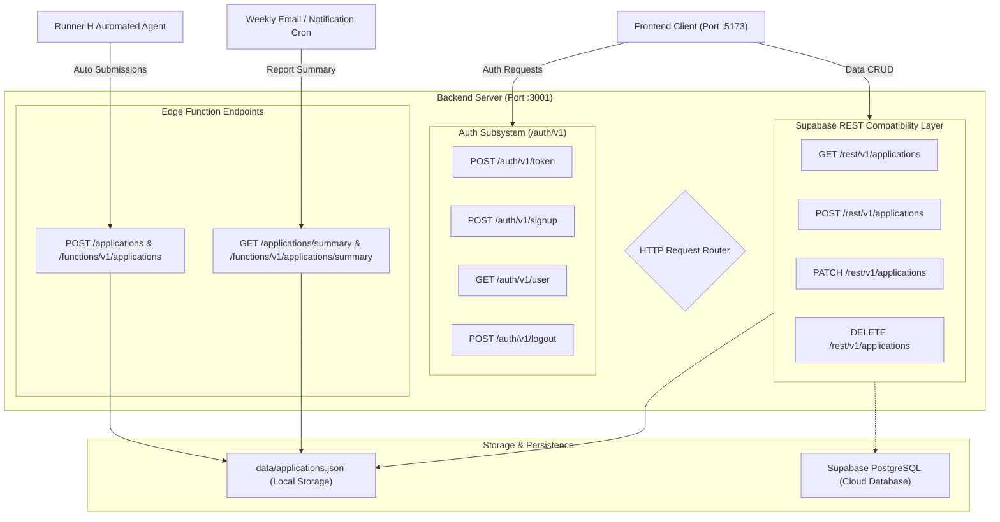
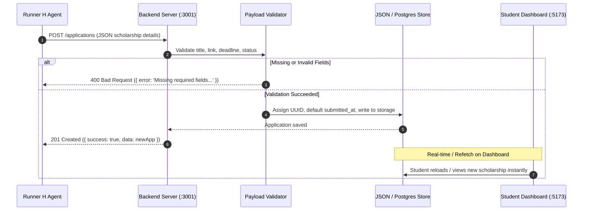

# Backend Workflow Specification

ScholarTrack features a dual-mode backend architecture designed to support both local standalone development and cloud deployment with **Supabase Edge Functions** (Deno) and the local Node.js API server (`server.cjs`).

---

## 1. Backend Architecture Overview



---

## 2. API Endpoints & Request Workflows

### 2.1 Runner H Automated Agent Endpoint

Enables automated AI agents (Runner H) to programmatically ingest scholarship applications directly into the database.

- **Route:** `POST /applications` or `POST /functions/v1/applications`
- **Method:** `POST`
- **Headers:**
  ```http
  Content-Type: application/json
  Authorization: Bearer <ANON_OR_SERVICE_ROLE_KEY>
  ```
- **Request Body:**
  ```json
  {
    "title": "Gates Millennium Scholarship",
    "link": "https://www.gatesfoundation.org/scholarships",
    "deadline": "2024-12-15",
    "status": "applied",
    "submitted_at": "2024-11-01T10:30:00Z",
    "notes": "Strong essay focusing on community service",
    "user_id": "optional-user-id"
  }
  ```
- **Response (`201 Created`):**
  ```json
  {
    "success": true,
    "data": {
      "id": "e4f87a82-1c23-4b55-a9b1-0987654321ab",
      "title": "Gates Millennium Scholarship",
      "link": "https://www.gatesfoundation.org/scholarships",
      "deadline": "2024-12-15",
      "status": "applied",
      "submitted_at": "2024-11-01T10:30:00Z",
      "notes": "Strong essay focusing on community service",
      "user_id": "00000000-0000-0000-0000-000000000000",
      "created_at": "2024-11-01T10:30:00.000Z",
      "updated_at": "2024-11-01T10:30:00.000Z"
    }
  }
  ```

---

### 2.2 Weekly Summary Endpoint

Aggregates statistics and categorizes upcoming scholarship deadlines for automated email reports.

- **Route:** `GET /applications/summary` or `GET /functions/v1/applications/summary`
- **Method:** `GET`
- **Response (`200 OK`):**
  ```json
  {
    "applied": [ ... ],
    "pending": [ ... ],
    "won": [ ... ],
    "rejected": [ ... ],
    "total": 8,
    "upcoming_deadlines": [
      {
        "id": "f1a2b3c4-1111-4000-8000-000000000001",
        "title": "Gates Millennium Scholarship",
        "deadline": "2024-12-15",
        "status": "applied"
      }
    ]
  }
  ```

---

### 2.3 Supabase Authentication Endpoints

Provides identity management compatible with `@supabase/supabase-js`.

| Endpoint | Method | Input | Description |
| :--- | :--- | :--- | :--- |
| `/auth/v1/token?grant_type=password` | `POST` | `{ email, password }` | Authenticates user credentials. Returns JWT access token and user profile. Supports `demo@scholartrack.com`. |
| `/auth/v1/signup` | `POST` | `{ email, password }` | Registers a new user account with a unique UUID. |
| `/auth/v1/user` | `GET` | Header `Bearer <token>` | Retrieves active user identity metadata. |
| `/auth/v1/logout` | `POST` | Header `Bearer <token>` | Invalidates active user session. |

---

### 2.4 Supabase PostgREST Table Endpoints (`/rest/v1/applications`)

Full CRUD interface with query parameter filters matching Supabase client protocol:

- **Filter by User ID:** `GET /rest/v1/applications?user_id=eq.<uuid>`
- **Filter Demo Applications:** `GET /rest/v1/applications?user_id=is.null`
- **Sorting:** `GET /rest/v1/applications?order=deadline.asc` or `order=created_at.desc`
- **Create:** `POST /rest/v1/applications` with body `[ { title, deadline, status, ... } ]`
- **Update / Claim:** `PATCH /rest/v1/applications?user_id=is.null` with body `{ user_id: "<current_user_id>" }`
- **Delete:** `DELETE /rest/v1/applications?id=eq.<uuid>`

---

## 3. Runner H Agent Processing Pipeline



---

## 4. Operational & Execution Commands

```bash
# Navigate to the project root
cd ScholarTrack

# 1. Start backend server
node server.cjs
# Server listens on: http://localhost:3001

# 2. Or run via npm script
npm run server

# 3. Test backend health check
curl http://localhost:3001/health

# 4. Test summary endpoint
curl http://localhost:3001/applications/summary

# 5. Ingest scholarship via Runner H API
curl -X POST http://localhost:3001/applications \
  -H "Content-Type: application/json" \
  -d '{"title":"STEM Leaders Grant","link":"https://example.com","deadline":"2025-05-01","status":"pending"}'
```
