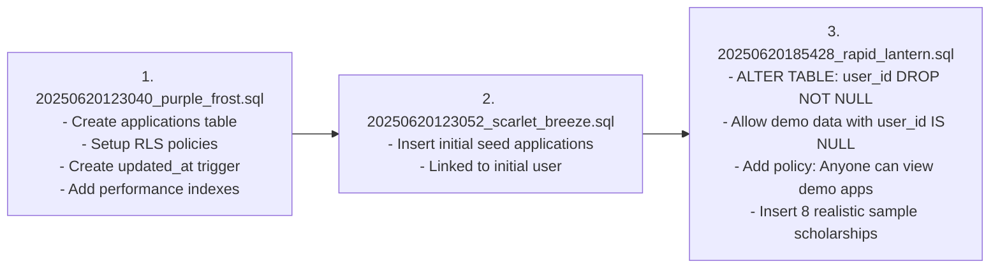
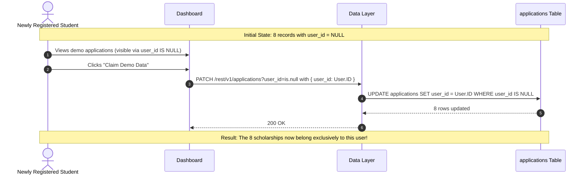

# Database & Persistence Workflow Specification

ScholarTrack's data tier is designed for dual deployment:
1. **Local Persistent Storage:** High-performance JSON file store (`data/applications.json`) for zero-dependency local development and testing.
2. **PostgreSQL Database:** Production database hosted on **Supabase** with comprehensive Row Level Security (RLS), automated timestamp triggers, and index optimizations.

---

## 1. Entity-Relationship & Schema Diagram

```mermaid
erDiagram
    AUTH_USERS {
        uuid id PK
        string email
        string encrypted_password
        timestamp created_at
    }

    APPLICATIONS {
        uuid id PK "gen_random_uuid()"
        text title "NOT NULL"
        text link "NOT NULL"
        date deadline "NOT NULL"
        text status "CHECK: applied, pending, won, rejected"
        timestamptz submitted_at "NULLABLE"
        text notes "DEFAULT ''"
        timestamptz created_at "DEFAULT now()"
        timestamptz updated_at "DEFAULT now()"
        uuid user_id FK "REFERENCES auth.users(id) ON DELETE CASCADE, NULLABLE"
    }

    AUTH_USERS ||--o{ APPLICATIONS : "owns (nullable for demo data)"
```



---

## 2. Table Schema Definition (`applications`)

| Field Name | Type | Constraints | Description |
| :--- | :--- | :--- | :--- |
| `id` | `uuid` | `PRIMARY KEY, DEFAULT gen_random_uuid()` | Unique application identifier. |
| `title` | `text` | `NOT NULL` | Scholarship name/title. |
| `link` | `text` | `NOT NULL` | Official application website or URL. |
| `deadline` | `date` | `NOT NULL` | Application deadline date (`YYYY-MM-DD`). |
| `status` | `text` | `NOT NULL, CHECK (status IN ('applied','pending','won','rejected'))` | Current lifecycle state. |
| `submitted_at` | `timestamptz` | `NULLABLE` | Timestamp when the application was formally submitted. |
| `notes` | `text` | `DEFAULT ''` | Student notes, essay focus, or requirements. |
| `created_at` | `timestamptz` | `DEFAULT now()` | Record creation timestamp. |
| `updated_at` | `timestamptz` | `DEFAULT now()` | Timestamp of last modification (auto-updated by trigger). |
| `user_id` | `uuid` | `REFERENCES auth.users(id) ON DELETE CASCADE, NULLABLE` | Foreign key referencing the authenticated student. Set to `NULL` for public demo scholarships. |

---

## 3. Database Migration Sequence

Database evolution is managed in `supabase/migrations/`:



### Detailed Migration Highlights:

#### 1. Table Creation & Trigger (`20250620123040_purple_frost.sql`)
- Enables table `applications` and activates `ROW LEVEL SECURITY`.
- Creates function `update_updated_at_column()` and attaches trigger `update_applications_updated_at` before updates.
- Creates indexes:
  - `idx_applications_user_id` on `applications(user_id)`
  - `idx_applications_status` on `applications(status)`
  - `idx_applications_deadline` on `applications(deadline)`

#### 2. Seed Data Injection (`20250620123052_scarlet_breeze.sql`)
- Seeds initial applications with placeholder user references.

#### 3. Demo Data Flexibility & RLS Expansion (`20250620185428_rapid_lantern.sql`)
- Alters `user_id` column to drop `NOT NULL` constraint, enabling shared demo scholarship applications.
- Adds public read policy:
  ```sql
  CREATE POLICY "Anyone can view demo applications"
    ON applications FOR SELECT
    TO authenticated
    USING (user_id IS NULL);
  ```
- Seeds 8 high-value scholarships (Gates Millennium, Coca-Cola, Dell, National Merit, etc.) with `user_id = NULL`.

---

## 4. Row Level Security (RLS) Policy Architecture

| Policy Name | Action | Permitted Role | Condition / Check |
| :--- | :--- | :--- | :--- |
| `Users can view own applications` | `SELECT` | `authenticated` | `auth.uid() = user_id` |
| `Anyone can view demo applications` | `SELECT` | `authenticated` | `user_id IS NULL` |
| `Users can insert own applications` | `INSERT` | `authenticated` | `WITH CHECK (auth.uid() = user_id)` |
| `Users can update own applications` | `UPDATE` | `authenticated` | `USING (auth.uid() = user_id)` |
| `Users can delete own applications` | `DELETE` | `authenticated` | `USING (auth.uid() = user_id)` |
| `Service role can insert applications` | `INSERT` | `service_role` | `WITH CHECK (true)` (Runner H AI agent access) |
| `Service role can manage demo applications` | `ALL` | `service_role` | `USING (user_id IS NULL) WITH CHECK (user_id IS NULL)` |

---

## 5. Seed Data Reference Catalog

The 8 pre-seeded scholarships include realistic deadlines, URLs, and submission notes:

1. **Gates Millennium Scholarship**
   - **Deadline:** 2024-12-15 | **Status:** `applied` | **Link:** [gatesfoundation.org](https://www.gatesfoundation.org/scholarships)
   - **Notes:** Strong essay submitted focusing on community service and leadership experience.
2. **National Merit Scholarship**
   - **Deadline:** 2024-11-30 | **Status:** `pending` | **Link:** [nationalmerit.org](https://www.nationalmerit.org/)
   - **Notes:** Waiting for PSAT scores to be released. Need to submit additional documentation.
3. **Coca-Cola Scholars Program**
   - **Deadline:** 2024-10-31 | **Status:** `won` | **Link:** [coca-colascholarsfoundation.org](https://www.coca-colascholarsfoundation.org/)
   - **Notes:** Received $20,000 scholarship! Interview went extremely well.
4. **Dell Scholars Program**
   - **Deadline:** 2024-12-01 | **Status:** `rejected` | **Link:** [dellscholars.org](https://www.dellscholars.org/)
   - **Notes:** Did not meet GPA requirements. Will reapply next year.
5. **Jack Kent Cooke Foundation Scholarship**
   - **Deadline:** 2024-11-25 | **Status:** `applied` | **Link:** [jkcf.org](https://www.jkcf.org/our-scholarships/)
   - **Notes:** Comprehensive application with financial aid documentation submitted.
6. **QuestBridge National College Match**
   - **Deadline:** 2024-12-10 | **Status:** `pending` | **Link:** [questbridge.org](https://www.questbridge.org/)
   - **Notes:** Application in progress. Need to complete college rankings.
7. **Hispanic Scholarship Fund**
   - **Deadline:** 2024-12-31 | **Status:** `applied` | **Link:** [hsf.net](https://www.hsf.net/)
   - **Notes:** Submitted application with community involvement emphasis.
8. **Elks National Foundation Most Valuable Student**
   - **Deadline:** 2024-11-20 | **Status:** `pending` | **Link:** [elks.org](https://www.elks.org/scholars/)
   - **Notes:** Waiting for school counselor recommendation letter.

---

## 6. Demo Data Claiming Workflow



---

## 7. Local File Persistence (`data/applications.json`)

For local execution without cloud Supabase overhead:
- **Location:** `ScholarTrack/data/applications.json`
- **Auto-initialization:** If the file does not exist, `server.cjs` automatically populates it with the 8 official seed scholarships.
- **Atomicity:** All create, update, claim, and delete mutations write through synchronously to `data/applications.json`.
- **Resetting Data:** To reset the database to factory settings, simply delete `data/applications.json` and restart the server:
  ```bash
  rm data/applications.json
  npm run server
  ```
