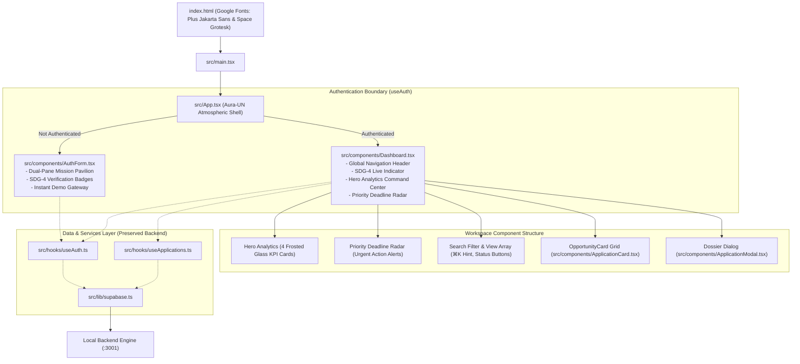

# Frontend Workflow Specification: Kaizen (UNESCO SDG-4)

Kaizen is a modern single-page web application built with **React 18**, **TypeScript**, **Tailwind CSS (Aura-UN Design System)**, and bundled with **Vite**. Re-engineered from the ground up as a global social service solution aligned with **UNESCO Sustainable Development Goal 4 (Ensure inclusive and equitable quality education)**.

---

## 1. Frontend Architecture Overview



---

## 2. Replaced Component Hierarchy & Upgrades

| Component | File Path | Major Upgrades in Rebrand |
| :--- | :--- | :--- |
| **Atmospheric Root** | `src/App.tsx` | Futuristic UN orbital spinner loading screen, atmospheric cyan/blue radial gradients, Space Grotesk font styling. |
| **Global Auth Portal** | `src/components/AuthForm.tsx` | Dual-pane layout: Left pane showcases UNESCO SDG-4 mission briefing, international impact metrics ($45M+ in verified opportunities), and zero-cost open access protocol. Right pane provides one-click instant demo login and scholar registration. |
| **Kaizen Dashboard** | `src/components/Dashboard.tsx` | Global top navigation with UNESCO badge, 4 frosted glass KPI command cards, **Priority Deadline Radar** banner for urgent deadlines, multi-field search with quick clear, and interactive filter pills. |
| **Opportunity Card** | `src/components/ApplicationCard.tsx` | Double-layered frosted acrylic glass (`glass-card glass-card-hover`), dynamic top status accent glow strip, live deadline countdown chips ("Overdue", "Due Today!", "X days left"), and quick milestone switcher. |
| **Opportunity Modal** | `src/components/ApplicationModal.tsx` | Glassmorphic floating dossier dialog with interactive 4-status milestone selector cards, formatted date pickers, link validator, and scholastic notes textarea. |

---

## 3. Aura-UN Design Tokens

- **UN Blue Spectrum:**
  - `un-500` (`#0077D4`): Authentic core UNESCO / UN Blue.
  - `un-600` (`#005FB8`) to `un-950` (`#051324`): Deep international navy palette.
  - `aurora-cyan` (`#00E5FF`): Luminescent accent glow.
- **Glassmorphism Physics:**
  - `glass-card`: `rgba(255, 255, 255, 0.78)` backdrop blur with specular white edge borders.
  - `glass-nav`: `backdrop-blur-2xl` floating navigation header.
  - `glass-input`: Translucent inputs with dynamic blue focus rings.

---

## 4. Execution Commands

```bash
# Frontend development server (Port 5173)
cd ScholarTrack
npm run dev

# Compile TypeScript & production bundle
npm run build
```
