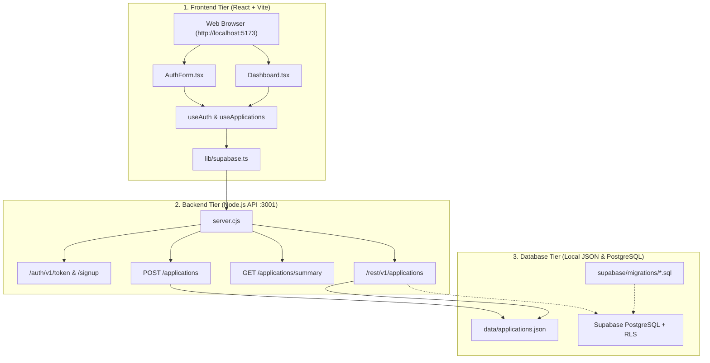

# ScholarTrack System Workflows

This directory contains detailed technical workflow specifications for the **Frontend**, **Backend**, and **Database** tiers of ScholarTrack.

---

## 📑 Workflow Documentation Directory

```
workflows/
├── FRONTEND_WORKFLOW.md   # UI architecture, state management, components, and user flows
├── BACKEND_WORKFLOW.md    # API endpoints, Runner H AI ingestion, authentication, summary reports
├── DATABASE_WORKFLOW.md   # Schema definition, SQL migrations, RLS security policies, seed data
└── README.md              # System overview, end-to-end architecture, and quick references
```

---

## 🌐 End-to-End System Architecture



---

## 🚀 Quick Execution Guide

### Start All Services Locally:

1. **Start the Backend Server (Port 3001):**
   ```bash
   cd ScholarTrack
   npm run server
   ```

2. **Start the Frontend Development Server (Port 5173):**
   ```bash
   cd ScholarTrack
   npm run dev
   ```

3. **Open the Application:**
   Navigate to [http://localhost:5173](http://localhost:5173) in your browser.

4. **Sign In With Demo Credentials:**
   - **Email:** `demo@scholartrack.com`
   - **Password:** `demo123456`
   - Or click **"Try Demo Account"** directly on the login form.

---

## 🔗 Direct Workflow Links

- 🖥️ **[Frontend Workflow Specification](./FRONTEND_WORKFLOW.md)**
- ⚙️ **[Backend Workflow Specification](./BACKEND_WORKFLOW.md)**
- 🗄️ **[Database & Persistence Workflow Specification](./DATABASE_WORKFLOW.md)**
